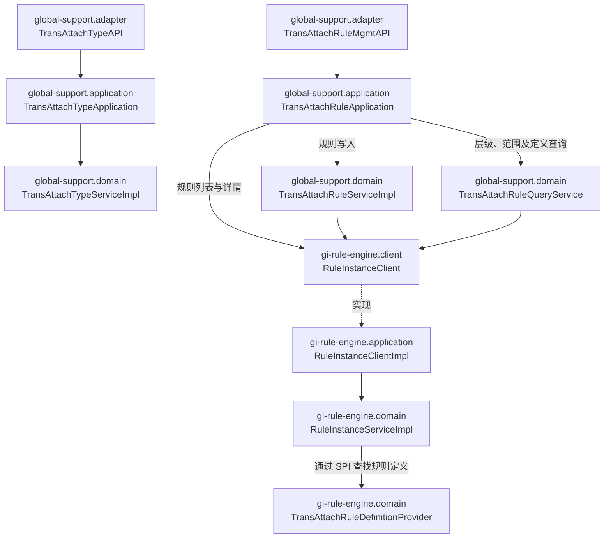
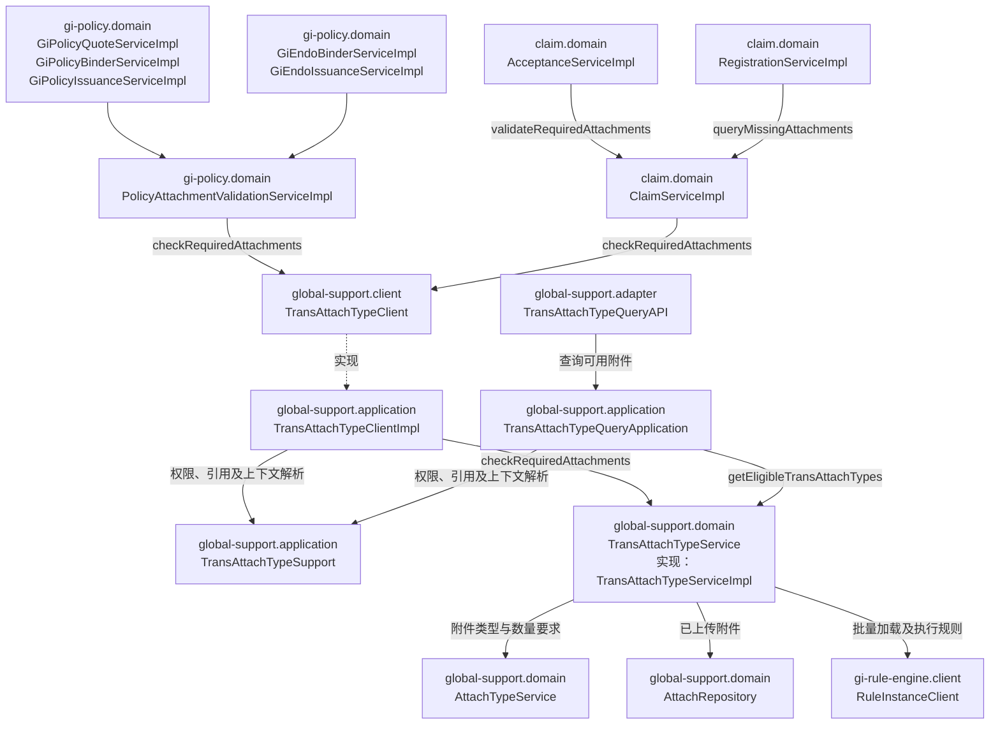
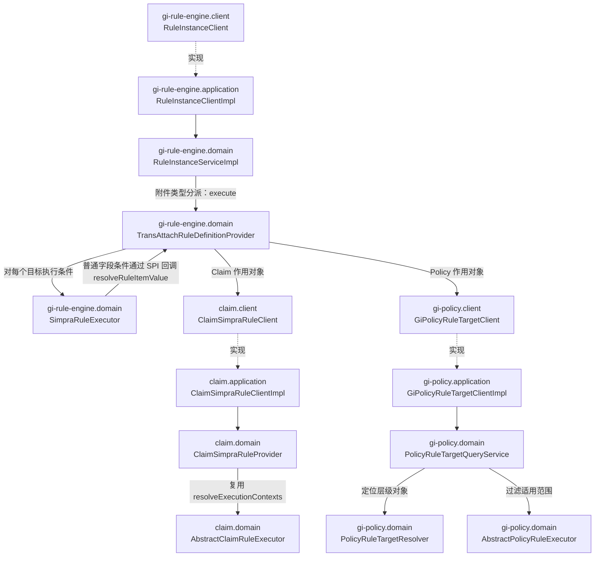

# TransAttach 调用关系实例

这是本次分析流程的源码快照与复查入口。后续分析先核实目录和版本，不直接复制类名作为当前事实。

- 核对日期：2026-11-03。
- 示例工程：`saas-service`。
- 源码基线：提交 `034695bc913`；仅代表历史快照，不代表当前实现。
- 源码路径相对 `saas-service` 仓库根目录，行号对应上述基线。
- 图为静态调用关系，辅助 DTO、Converter、枚举和部分 Repository 调用未全部展开。普通箭头为调用，虚线标注接口实现；不表示 Gradle 编译依赖。

## 模块分工

| 模块 | 职责 |
|---|---|
| global-support | 附件主配置、规则维护、适用性与必传计算、上传附件计数 |
| gi-rule-engine | 规则实例、条件定义、目标对象分派与条件执行 |
| claim | 理赔上下文、原 Ruleset 层级定位、理赔生命周期校验入口 |
| gi-policy | 保单权限、原 Ruleset 目标定位、保单与批改生命周期校验入口 |
| gi-product | 配置时的产品、保障及范围元数据 |
| claim-config | 理赔配置选项；Java package 可能仍以 `com.bytesforce.client.claim` 开头 |

## 配置维护



`TransAttachTypeServiceImpl` 负责主配置及运行时规则判断；规则编辑仍由 `TransAttachRuleServiceImpl` 处理，`TransAttachRuleQueryService` 提供层级、范围和条件定义。子规则变更的发布版本登记与变更日志仍由 `TransAttachRuleApplication` 编排。

## 业务运行时：谁调用附件检查



- Client 实现直接调用 Domain Service，不调用 `TransAttachTypeQueryApplication`。Client 边界保留参数校验、授权上下文解析、只读事务及 DTO 转换。
- 同一个 `TransAttachTypeServiceImpl` 先筛选适用配置，再计算 Eligibility 和 Mandatory，最后统计有效文件并返回缺失项。
- Eligibility 决定是否适用，适用后才计算 Mandatory。完全没有新规则的历史配置保留旧 mandatory 标记语义；新规则被禁用不等同于没有新规则。
- Claim Acceptance 在有关接受动作中调用阻断校验；Registration 只查询缺失项，当前调用处未使用返回结果，不能将其描述为缺附件即阻止登记。依赖调用异常仍可能向上传播。
- 保单和批改的上述调用点通过 `PolicyAttachmentValidationServiceImpl` 解释缺失结果并阻止相应动作；不表示所有保单操作都会执行此校验。

## 规则执行与业务模块回调



`TransAttachRuleDefinitionProvider` 同时承担附件条件定义、字段取值和执行协调。它委托 `SimpraRuleExecutor` 执行完整条件，并保留历史字段路径绑定及 finally 中的上下文恢复。字段取值回调不会再次调用完整的 `execute`。

Claim 复用原 Ruleset 的上下文、层级解析和业务字段能力；Policy 复用原目标定位及范围过滤。附件仍执行自己的 Eligibility/Mandatory 实例，不会触发整套审批、风险提示或其他业务 Ruleset。

## 上下文、定义与数据协作补充

| 调用方 | 被调用方 | 用途 |
|---|---|---|
| global-support.application · TransAttachTypeSupport | claim.client · ClaimSimpraRuleClient | loadRuleExecutionContext，固定 Claim/Version/SubClaim 范围 |
| global-support.application · TransAttachTypeSupport | gi-policy.client · GiPolicyClient | checkAttachmentReadAccess，检查保单附件读取权限 |
| global-support.domain · TransAttachRuleQueryService | claim.client · ClaimSimpraRuleClient | 查询理赔范围选项 |
| global-support.domain · TransAttachRuleQueryService | gi-product.client · GiProductClient / GiPrdtCoverClient | 查询产品与保障范围选项 |
| gi-rule-engine.domain · TransAttachRuleDefinitionProvider | claim.client · ClaimSimpraRuleClient | 获取已有理赔规则字段目录 |
| gi-rule-engine.domain · TransAttachRuleDefinitionProvider | gi-policy.client · GiPolicySimpraRuleClient | 按保单层级读取字段目录及取值 |
| claim.domain · ClaimSimpraRuleProvider | claim-config.client · ClaimLossTypeClient | 读取 Loss Type 配置 |
| global-support.domain · TransAttachTypeServiceImpl | global-support.domain · TransAttachTypeRepository | 主配置读取与维护；实现位于 global-support.infrastructure |
| global-support.domain · TransAttachTypeServiceImpl | global-support.domain · BlobService | 批量校验上传文件元数据 |

## 本次处理路径

1. 从 TransAttach 搜索实际生产声明及调用方，先区分主配置维护、页面查询和业务校验。
2. 顺着 `checkRequiredAttachments` 找到 Claim/Policy 业务入口，并追到规则引擎如何回调业务对象解析。
3. 根据 Gradle 目录标注 `模块.子模块`，将真实 Java package 单独列出，避免同包跨模块时标错。
4. 用户要求 Client 直接调用服务：移除 Client → QueryApplication 调用，把原边界编排放回 Client 实现。
5. 用户要求服务高内聚：将 Requirement 的运行时计算与检查合并到既有 `TransAttachTypeService / Impl`，移除旧接口和实现。
6. 用户要求规则定义与执行合并：将执行协调迁入 `TransAttachRuleDefinitionProvider`，更改 `RuleInstanceServiceImpl` 调用，移除 ExecutionService。
7. 迁移并保留核心测试，复查旧名称引用及源码调用图，完成编译和 40 项测试后提交 `034695bc913`。这些是本次执行结果，后续不能沿用为新版本的验证结论。

已删除的 Requirement、ExecutionService、ClaimAttachment 专用服务和自定义枚举反序列化类，只能出现在历史变更说明，不作为这份快照的有效调用节点。

## 后续复用

```text
使用 $module-callgraph 基于当前工作区重新梳理 TransAttach，给出配置维护、业务运行时和规则执行三张图，每个类标注模块.子模块，并说明与 034695bc913 示例的差异。
```

重新读取源码；不因本实例中出现过某个类就断言它仍然存在。仅分析时不运行 pull、merge 或修改源码。

## 类、模块与真实 Java package

由候选清单脚本定位生产声明；调用边仍依据正文核对。表中的路径相对示例工程根目录；当前技能仓库不包含该工程源码，需在对应源码版本中定位。

| 类 | 模块.子模块 | Java package | 源码 |
|---|---|---|---|
| `TransAttachTypeAPI` | `global-support.adapter` | `com.bytesforce.adapter.support.web` | `global-support/global-support-adapter/src/main/groovy/com/bytesforce/adapter/support/web/TransAttachTypeAPI.groovy:47` |
| `TransAttachTypeApplication` | `global-support.application` | `com.bytesforce.application.support.internal` | `global-support/global-support-application/src/main/groovy/com/bytesforce/application/support/internal/TransAttachTypeApplication.groovy:53` |
| `TransAttachTypeService` | `global-support.domain` | `com.bytesforce.domain.support.service` | `global-support/global-support-domain/src/main/groovy/com/bytesforce/domain/support/service/TransAttachTypeService.groovy:20` |
| `TransAttachTypeServiceImpl` | `global-support.domain` | `com.bytesforce.domain.support.service.impl` | `global-support/global-support-domain/src/main/groovy/com/bytesforce/domain/support/service/impl/TransAttachTypeServiceImpl.groovy:71` |
| `TransAttachRuleMgmtAPI` | `global-support.adapter` | `com.bytesforce.adapter.support.web` | `global-support/global-support-adapter/src/main/groovy/com/bytesforce/adapter/support/web/TransAttachRuleMgmtAPI.groovy:27` |
| `TransAttachRuleApplication` | `global-support.application` | `com.bytesforce.application.support.internal` | `global-support/global-support-application/src/main/groovy/com/bytesforce/application/support/internal/TransAttachRuleApplication.groovy:40` |
| `TransAttachRuleServiceImpl` | `global-support.domain` | `com.bytesforce.domain.support.service.impl` | `global-support/global-support-domain/src/main/groovy/com/bytesforce/domain/support/service/impl/TransAttachRuleServiceImpl.groovy:34` |
| `TransAttachRuleQueryService` | `global-support.domain` | `com.bytesforce.domain.support.service.attachment` | `global-support/global-support-domain/src/main/groovy/com/bytesforce/domain/support/service/attachment/TransAttachRuleQueryService.groovy:31` |
| `RuleInstanceClient` | `gi-rule-engine.client` | `com.bytesforce.client.gi.ruleset` | `gi-rule-engine/gi-rule-engine-client/src/main/groovy/com/bytesforce/client/gi/ruleset/RuleInstanceClient.groovy:10` |
| `RuleInstanceClientImpl` | `gi-rule-engine.application` | `com.bytesforce.application.gi.ruleset.client` | `gi-rule-engine/gi-rule-engine-application/src/main/groovy/com/bytesforce/application/gi/ruleset/client/RuleInstanceClientImpl.groovy:32` |
| `RuleInstanceServiceImpl` | `gi-rule-engine.domain` | `com.bytesforce.domain.gi.ruleset.service.impl` | `gi-rule-engine/gi-rule-engine-domain/src/main/groovy/com/bytesforce/domain/gi/ruleset/service/impl/RuleInstanceServiceImpl.groovy:45` |
| `TransAttachRuleDefinitionProvider` | `gi-rule-engine.domain` | `com.bytesforce.domain.gi.ruleset.service.impl.support.attachment` | `gi-rule-engine/gi-rule-engine-domain/src/main/groovy/com/bytesforce/domain/gi/ruleset/service/impl/support/attachment/TransAttachRuleDefinitionProvider.groovy:35` |
| `GiPolicyQuoteServiceImpl` | `gi-policy.domain` | `com.bytesforce.domain.gi.policy.service.impl` | `gi-policy/gi-policy-domain/src/main/groovy/com/bytesforce/domain/gi/policy/service/impl/GiPolicyQuoteServiceImpl.groovy:59` |
| `GiPolicyBinderServiceImpl` | `gi-policy.domain` | `com.bytesforce.domain.gi.policy.service.impl` | `gi-policy/gi-policy-domain/src/main/groovy/com/bytesforce/domain/gi/policy/service/impl/GiPolicyBinderServiceImpl.groovy:52` |
| `GiPolicyIssuanceServiceImpl` | `gi-policy.domain` | `com.bytesforce.domain.gi.policy.service.impl` | `gi-policy/gi-policy-domain/src/main/groovy/com/bytesforce/domain/gi/policy/service/impl/GiPolicyIssuanceServiceImpl.groovy:49` |
| `GiEndoBinderServiceImpl` | `gi-policy.domain` | `com.bytesforce.domain.gi.endo.gateway.service.impl` | `gi-policy/gi-policy-domain/src/main/groovy/com/bytesforce/domain/gi/endo/gateway/service/impl/GiEndoBinderServiceImpl.groovy:64` |
| `GiEndoIssuanceServiceImpl` | `gi-policy.domain` | `com.bytesforce.domain.gi.endo.gateway.service.impl` | `gi-policy/gi-policy-domain/src/main/groovy/com/bytesforce/domain/gi/endo/gateway/service/impl/GiEndoIssuanceServiceImpl.groovy:65` |
| `PolicyAttachmentValidationServiceImpl` | `gi-policy.domain` | `com.bytesforce.domain.gi.policy.service.impl` | `gi-policy/gi-policy-domain/src/main/groovy/com/bytesforce/domain/gi/policy/service/impl/PolicyAttachmentValidationServiceImpl.groovy:20` |
| `AcceptanceServiceImpl` | `claim.domain` | `com.bytesforce.domain.claim.service.trans.impl` | `claim/claim-domain/src/main/groovy/com/bytesforce/domain/claim/service/trans/impl/AcceptanceServiceImpl.groovy:41` |
| `RegistrationServiceImpl` | `claim.domain` | `com.bytesforce.domain.claim.service.trans.impl` | `claim/claim-domain/src/main/groovy/com/bytesforce/domain/claim/service/trans/impl/RegistrationServiceImpl.groovy:41` |
| `ClaimServiceImpl` | `claim.domain` | `com.bytesforce.domain.claim.service.model.impl` | `claim/claim-domain/src/main/groovy/com/bytesforce/domain/claim/service/model/impl/ClaimServiceImpl.groovy:52` |
| `TransAttachTypeClient` | `global-support.client` | `com.bytesforce.client.support` | `global-support/global-support-client/src/main/groovy/com/bytesforce/client/support/TransAttachTypeClient.groovy:13` |
| `TransAttachTypeClientImpl` | `global-support.application` | `com.bytesforce.application.support.client` | `global-support/global-support-application/src/main/groovy/com/bytesforce/application/support/client/TransAttachTypeClientImpl.groovy:40` |
| `TransAttachTypeQueryAPI` | `global-support.adapter` | `com.bytesforce.adapter.support.web` | `global-support/global-support-adapter/src/main/groovy/com/bytesforce/adapter/support/web/TransAttachTypeQueryAPI.groovy:22` |
| `TransAttachTypeQueryApplication` | `global-support.application` | `com.bytesforce.application.support.internal` | `global-support/global-support-application/src/main/groovy/com/bytesforce/application/support/internal/TransAttachTypeQueryApplication.groovy:32` |
| `TransAttachTypeSupport` | `global-support.application` | `com.bytesforce.application.support.internal` | `global-support/global-support-application/src/main/groovy/com/bytesforce/application/support/internal/TransAttachTypeSupport.groovy:30` |
| `AttachTypeService` | `global-support.domain` | `com.bytesforce.domain.support.service` | `global-support/global-support-domain/src/main/groovy/com/bytesforce/domain/support/service/AttachTypeService.groovy:5` |
| `AttachRepository` | `global-support.domain` | `com.bytesforce.domain.support.gateway.repository` | `global-support/global-support-domain/src/main/groovy/com/bytesforce/domain/support/gateway/repository/AttachRepository.groovy:7` |
| `SimpraRuleExecutor` | `gi-rule-engine.domain` | `com.bytesforce.domain.gi.ruleset.service.impl.support.ruleinstance.executor.impl` | `gi-rule-engine/gi-rule-engine-domain/src/main/groovy/com/bytesforce/domain/gi/ruleset/service/impl/support/ruleinstance/executor/impl/SimpraRuleExecutor.groovy:38` |
| `ClaimSimpraRuleClient` | `claim.client` | `com.bytesforce.client.claim` | `claim/claim-client/src/main/groovy/com/bytesforce/client/claim/ClaimSimpraRuleClient.groovy:9` |
| `ClaimSimpraRuleClientImpl` | `claim.application` | `com.bytesforce.application.claim.client` | `claim/claim-application/src/main/groovy/com/bytesforce/application/claim/client/ClaimSimpraRuleClientImpl.groovy:15` |
| `ClaimSimpraRuleProvider` | `claim.domain` | `com.bytesforce.domain.claim.provider` | `claim/claim-domain/src/main/groovy/com/bytesforce/domain/claim/provider/ClaimSimpraRuleProvider.groovy:56` |
| `AbstractClaimRuleExecutor` | `claim.domain` | `com.bytesforce.domain.claim.service.trans.support` | `claim/claim-domain/src/main/groovy/com/bytesforce/domain/claim/service/trans/support/AbstractClaimRuleExecutor.groovy:48` |
| `GiPolicyRuleTargetClient` | `gi-policy.client` | `com.bytesforce.client.gi.policy` | `gi-policy/gi-policy-client/src/main/groovy/com/bytesforce/client/gi/policy/GiPolicyRuleTargetClient.groovy:6` |
| `GiPolicyRuleTargetClientImpl` | `gi-policy.application` | `com.bytesforce.application.gi.policy.client` | `gi-policy/gi-policy-application/src/main/groovy/com/bytesforce/application/gi/policy/client/GiPolicyRuleTargetClientImpl.groovy:19` |
| `PolicyRuleTargetQueryService` | `gi-policy.domain` | `com.bytesforce.domain.gi.policy.ruleset.execution` | `gi-policy/gi-policy-domain/src/main/groovy/com/bytesforce/domain/gi/policy/ruleset/execution/PolicyRuleTargetQueryService.groovy:16` |
| `PolicyRuleTargetResolver` | `gi-policy.domain` | `com.bytesforce.domain.gi.policy.ruleset.execution` | `gi-policy/gi-policy-domain/src/main/groovy/com/bytesforce/domain/gi/policy/ruleset/execution/PolicyRuleTargetResolver.groovy:28` |
| `AbstractPolicyRuleExecutor` | `gi-policy.domain` | `com.bytesforce.domain.gi.policy.ruleset.executor` | `gi-policy/gi-policy-domain/src/main/groovy/com/bytesforce/domain/gi/policy/ruleset/executor/AbstractPolicyRuleExecutor.groovy:22` |
| `ClaimLossTypeClient` | `claim-config.client` | `com.bytesforce.client.claim` | `claim-config/claim-config-client/src/main/groovy/com/bytesforce/client/claim/ClaimLossTypeClient.groovy:7` |
| `GiPolicyClient` | `gi-policy.client` | `com.bytesforce.client.gi.policy` | `gi-policy/gi-policy-client/src/main/groovy/com/bytesforce/client/gi/policy/GiPolicyClient.groovy:12` |
| `GiProductClient` | `gi-product.client` | `com.bytesforce.client.gi.product` | `gi-product/gi-product-client/src/main/groovy/com/bytesforce/client/gi/product/GiProductClient.groovy:14` |
| `GiPrdtCoverClient` | `gi-product.client` | `com.bytesforce.client.gi.product` | `gi-product/gi-product-client/src/main/groovy/com/bytesforce/client/gi/product/GiPrdtCoverClient.groovy:19` |
| `GiPolicySimpraRuleClient` | `gi-policy.client` | `com.bytesforce.client.gi.policy` | `gi-policy/gi-policy-client/src/main/groovy/com/bytesforce/client/gi/policy/GiPolicySimpraRuleClient.groovy:7` |
| `TransAttachTypeRepository` | `global-support.domain` | `com.bytesforce.domain.support.gateway.repository` | `global-support/global-support-domain/src/main/groovy/com/bytesforce/domain/support/gateway/repository/TransAttachTypeRepository.groovy:11` |
| `BlobService` | `global-support.domain` | `com.bytesforce.domain.support.service` | `global-support/global-support-domain/src/main/groovy/com/bytesforce/domain/support/service/BlobService.groovy:8` |
